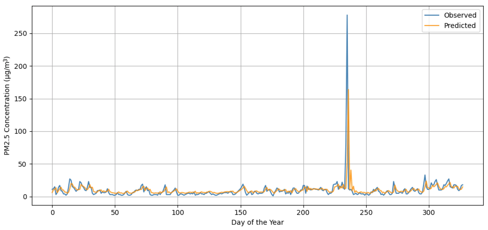
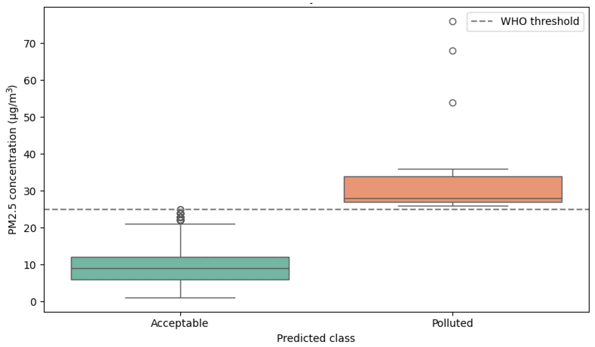

 
  

------------------------------------------------------------------------

## 🔗 Direct access

-   📄 [Published article](https://doi.org/10.3390/math13121979)
-   💻 [Analytical notebook](notebook.html)
-   🧪 [Scripts and code provenance](scripts.html)
-   💾 [GitHub repository](https://github.com/jcaceres-academic/urban-pm25-classical-quantum)

------------------------------------------------------------------------

## 🧠 Overview

This repository contains the reproducible and recovered computational materials associated with the article **“Mathematical Evaluation of Classical and Quantum Predictive Models Applied to PM2.5 Forecasting in Urban Environments.”**

The study compares two different predictive paradigms applied to real PM2.5 observations from the Plaza Castilla monitoring station in Madrid:

-   **Long Short-Term Memory (LSTM)** for continuous time-series prediction;
-   **Quantum Support Vector Machine (QSVM)** for binary classification using quantum kernels.

The broader objective is not to treat both models as functionally equivalent, but to examine how classical and quantum approaches behave under the same environmental-data context in terms of predictive capability, classification performance and computational efficiency.

------------------------------------------------------------------------

## 🎯 Research objective

The study evaluates the strengths and limitations of classical and quantum machine-learning approaches in a high-variability urban environmental setting.

The empirical analysis focuses on:

1.  temporal PM2.5 behaviour;
2.  LSTM forecasting performance;
3.  QSVM threshold classification;
4.  computational time and memory usage;
5.  the potential complementarity of classical and quantum models.

------------------------------------------------------------------------

## 🧩 Experimental framework

The article organises the empirical workflow using an adapted **Knowledge Discovery in Databases (KDD)** process.

{fig-align="center" width="66%"}

**Fig. 1.** KDD process adapted to the comparative modelling of LSTM and QSVM.

The modelling stage deliberately compares two different task formulations:

| Model | Paradigm | Main task | Output |
|------------------|------------------|------------------|------------------|
| LSTM | Classical deep learning | Time-series regression | Continuous PM2.5 prediction |
| QSVM | Quantum kernel method | Binary classification | Acceptable / polluted class |

------------------------------------------------------------------------

## 📈 Classical model: LSTM

The LSTM experiment uses the Plaza Castilla PM2.5 series to forecast continuous concentration values.

The published implementation describes a single LSTM layer with **64 units**, followed by a dense output layer, trained for **50 epochs** with the **Adam** optimizer and **MSE** loss after MinMax normalization.

{fig-align="center" width="84%"}

**Fig. 2.** Observed and predicted PM2.5 values for the 2024 LSTM evaluation.

The article reports:

-   **RMSE:** 15.98 µg/m³
-   **MAE:** 4.42 µg/m³
-   **R²:** 0.05
-   **Training time:** 29.68 s
-   **Peak memory:** 53.22 MB

The main limitation is the underestimation of extreme pollution peaks.

------------------------------------------------------------------------

## ⚛️ Quantum model: QSVM

The quantum experiment reformulates the problem as binary classification using a **25 µg/m³ threshold**.

The implementation described in the article uses:

-   Qiskit;
-   `ZFeatureMap`;
-   three qubits;
-   depth 2;
-   angle encoding;
-   a fidelity-based quantum kernel;
-   and a classical statevector simulator.

{fig-align="center" width="68%"}

**Fig. 3.** Distribution of real PM2.5 concentrations by predicted QSVM class.

The article reports perfect classification metrics in the evaluated experiment and a training time of **0.08 s**, with peak memory usage of **54.89 MB**.

------------------------------------------------------------------------

## 📌 Main interpretation

The two approaches solve different but complementary tasks.

-   **LSTM** preserves temporal continuity and provides continuous forecasts.
-   **QSVM** provides a threshold-based decision mechanism with strong class separation in the reported experiment.
-   LSTM is more informative for concentration trajectories, but struggles with extreme events.
-   QSVM is more limited in output type, but offers a compact decision boundary for threshold classification.
-   The study frames both paradigms as potentially complementary components of future hybrid environmental-intelligence systems.

------------------------------------------------------------------------

## 🔬 Reproducibility status

The complete original computational environment was not preserved.

This repository therefore distinguishes between:

-   **recovered code** from the original Google Colab notebook;
-   **reconstructed code** based on the methodological details reported in the article;
-   and **published results** transcribed directly from the paper.

The [Scripts and code provenance](scripts.html) page documents this distinction explicitly.

------------------------------------------------------------------------

## ⚠️ Published-method notes

The article contains two internal inconsistencies that are preserved transparently rather than silently reconciled:

-   the methodology section describes an **80/20 split** of 330 daily observations, while the dedicated LSTM section describes **2017–2023 as training data and 2024 as an external test set**;
-   the dedicated LSTM results table reports **R² = 0.05**, whereas the later comparative table contains a different value for the LSTM R² score.

For reproducibility purposes, this repository treats the model-specific LSTM section and its dedicated metrics table as the primary source for the reconstructed LSTM experiment.

------------------------------------------------------------------------

## 📚 Citation

> Cáceres-Tello, J., & Galán-Hernández, J. J. (2025).\
> *Mathematical Evaluation of Classical and Quantum Predictive Models Applied to PM2.5 Forecasting in Urban Environments.*\
> **Mathematics, 13**, 1979.\
> https://doi.org/10.3390/math13121979

------------------------------------------------------------------------

## 📬 Contact

**Jesús Cáceres Tello**\
Complutense University of Madrid

📧 [jescacer\@ucm.es](mailto:jescacer@ucm.es)\
📧 [jcaceres.academic\@gmail.com](mailto:jcaceres.academic@gmail.com)

⬅️ [Back to Academic Home](https://jcaceres-academic.github.io/)
