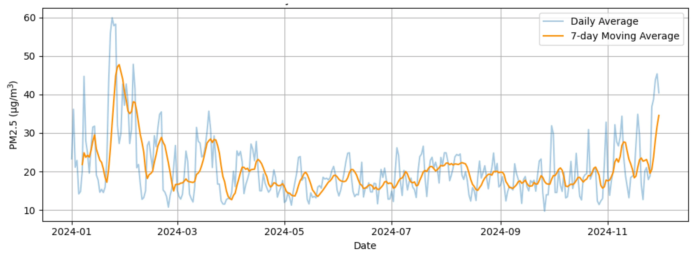
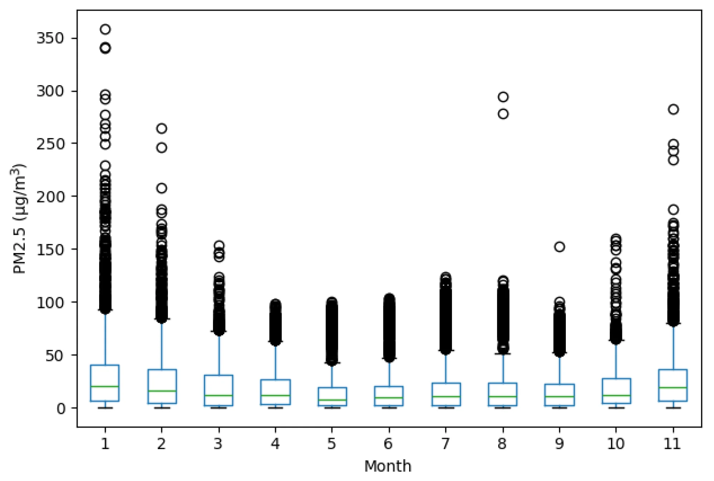
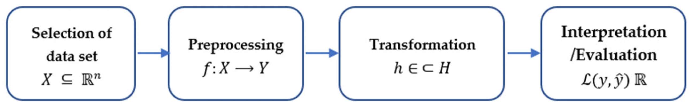
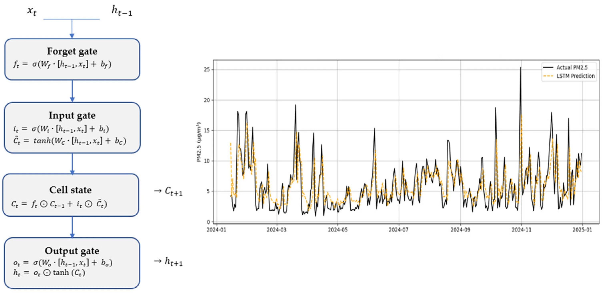
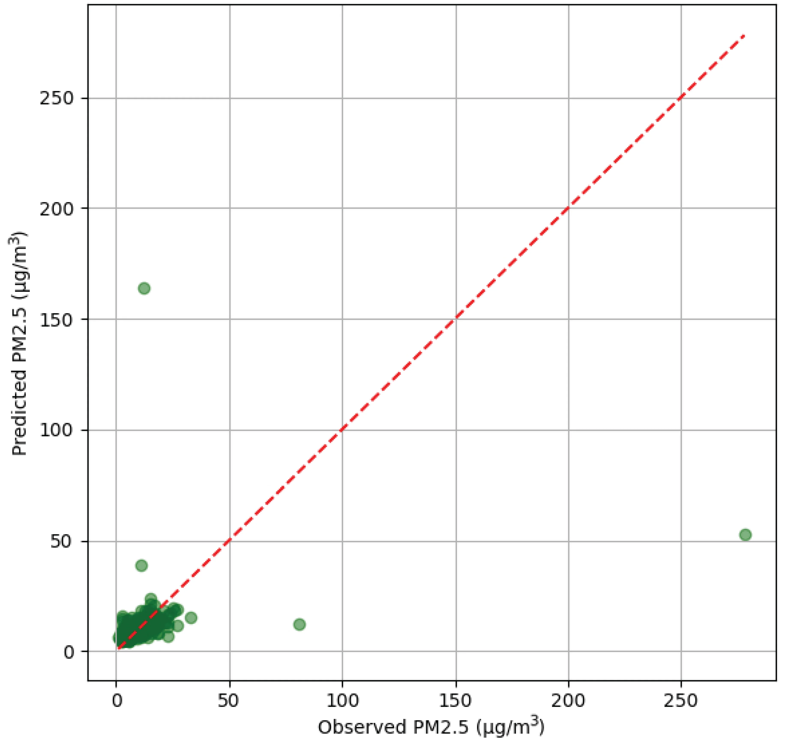
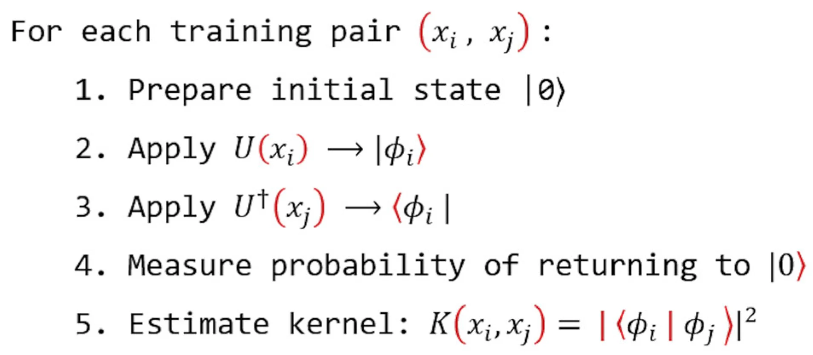
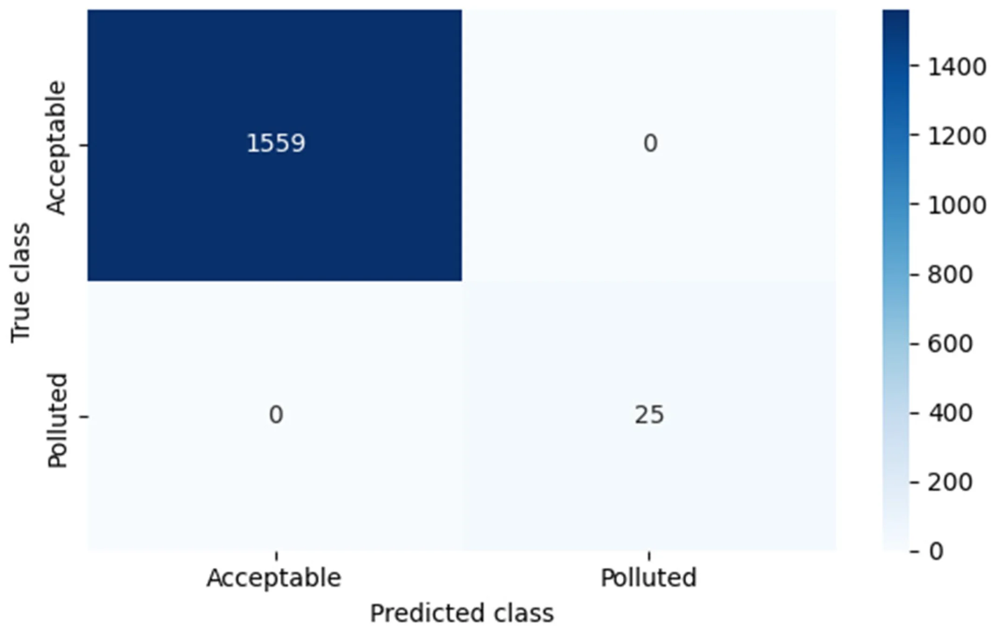
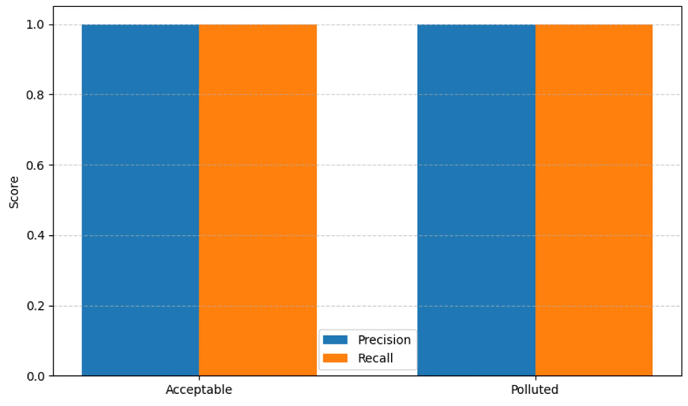

[](https://creativecommons.org/licenses/by/4.0/) 
[](https://quarto.org/) [](https://doi.org/10.3390/math13121979) [](https://doi.org/10.5281/zenodo.23880802)

------------------------------------------------------------------------

## 🧠 Purpose

This notebook complements the project home page with the analytical details of the published experiments.

The home page already presents the overall KDD framework and the central LSTM/QSVM comparison. Here the focus is on:

- PM2.5 temporal behaviour;
- classical LSTM model foundations and diagnostics;
- quantum-kernel logic;
- QSVM classification diagnostics;
- and methodological limitations relevant to reproducibility.

------------------------------------------------------------------------

## 🌫️ PM2.5 data: Plaza Castilla

The study uses real PM2.5 observations from the **Plaza Castilla** monitoring station in Madrid.

For the descriptive analysis of 2024, the article reports **330 valid daily observations** after cleaning and transformation.

{fig-align="center" width="84%"}

**Fig. 1.** Daily PM2.5 evolution and 7-day moving average for Plaza Castilla in 2024.

The series shows clear temporal variability, including pronounced winter peaks.

------------------------------------------------------------------------

## 📊 Monthly variability

{fig-align="center" width="72%"}

**Fig. 2.** Monthly distribution of PM2.5 values.

The article highlights greater dispersion and more outliers during winter months, while the middle months of the year show more compact distributions.

------------------------------------------------------------------------

## 🧩 Mathematical KDD representation

The article formalises the KDD workflow through data transformation, attribute selection, hypothesis construction and model evaluation.

{fig-align="center" width="72%"}

**Fig. 3.** Mathematical representation of the KDD process.

This formalisation provides the common methodological context for both predictive paradigms.

------------------------------------------------------------------------

## 🧠 LSTM model

The LSTM architecture is presented as the classical sequence-based model.

{fig-align="center" width="82%"}

**Fig. 4.** LSTM cell structure and example PM2.5 prediction.

The published implementation specifies:

- one LSTM layer;
- 64 units;
- dense output layer;
- 50 epochs;
- Adam optimizer;
- MSE loss;
- MinMax normalization to `[0,1]`.

The dedicated LSTM section states that data from **2017–2023** were used for training and **2024** as an external test set.

------------------------------------------------------------------------

## 📉 LSTM error structure

The observed-vs-predicted scatter plot exposes the main limitation of the classical model.

{fig-align="center" width="70%"}

**Fig. 5.** Scatter plot of predicted versus observed PM2.5 values.

The model performs reasonably at low-to-moderate concentrations but increasingly underestimates high-concentration events.

Reported test metrics:

| Metric | Value |
|---|---:|
| RMSE | 15.98 µg/m³ |
| MAE | 4.42 µg/m³ |
| R² | 0.05 |
| Training time | 29.68 s |
| Peak memory usage | 53.22 MB |

------------------------------------------------------------------------

## ⚛️ Quantum-kernel logic

The QSVM approach maps classical feature vectors into a quantum feature space and evaluates similarity through a quantum kernel.

{fig-align="center" width="68%"}

**Fig. 6.** Pseudocode for estimating the quantum kernel from the fidelity between parameterised quantum states.

The article describes a Qiskit implementation using a `ZFeatureMap`, angle encoding and a statevector simulator.

The target variable is binarised using **25 µg/m³**:

- **Class 0:** PM2.5 ≤ 25 µg/m³
- **Class 1:** PM2.5 > 25 µg/m³

------------------------------------------------------------------------

## ✅ QSVM classification diagnostics

{fig-align="center" width="68%"}

**Fig. 7.** Confusion matrix for the QSVM classification experiment.

The reported experiment shows no misclassifications.

{fig-align="center" width="68%"}

**Fig. 8.** Precision and recall by class.

The article reports precision, recall and F1-score of **1.00** for both classes in the evaluated configuration.

Reported computational resources:

| Resource | QSVM |
|---|---:|
| Training time | 0.08 s |
| Peak memory usage | 54.89 MB |

------------------------------------------------------------------------

## 🧭 Cross-paradigm interpretation

The comparison must be interpreted carefully because the models do not solve the same prediction task:

- LSTM performs **continuous regression** over a temporal sequence;
- QSVM performs **binary classification** relative to a pollution threshold.

The study therefore frames the comparison as cross-paradigm rather than as a strict like-for-like benchmark.

The main methodological value lies in showing how both approaches respond to the same environmental context under different operational objectives.

------------------------------------------------------------------------

## ⚠️ Reproducibility notes

Two discrepancies in the published article are relevant when reconstructing the experiments:

### Data splitting

The general methodology section describes an **80/20 split** based on 330 observations.

The dedicated LSTM section instead describes **2017–2023 for training and 2024 for external testing**.

The reconstructed LSTM script follows the dedicated LSTM section.

### LSTM R²

The dedicated LSTM results table reports:

```text
R² = 0.05
```

A later comparative table reports a different LSTM R² value.

The repository therefore uses the metric reported in the dedicated LSTM results section and flags the later discrepancy rather than attempting to resolve it retrospectively.

------------------------------------------------------------------------

## 🔬 Code provenance

The original Google Colab notebook has been preserved in the repository.

The QSVM-related code is partly recoverable from that notebook, whereas the complete original LSTM source code was not recovered. The reconstructed implementation follows the model-specific parameters published in the article.

See [Scripts and code provenance](scripts.html) for details.

------------------------------------------------------------------------

## 📚 Article

**DOI:** [10.3390/math13121979](https://doi.org/10.3390/math13121979)

------------------------------------------------------------------------

## ⬅️ Navigation

[Project home](index.html) · [Scripts and code provenance](scripts.html) · [Academic Home](https://jcaceres-academic.github.io/)
